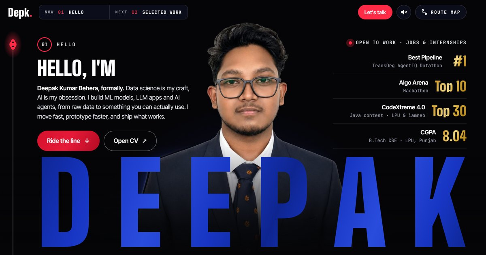

# Deepak Kumar Behera · The Deepak Line

Live: **https://deepak17kb.github.io/**



My portfolio is laid out as a metro line. A red route runs down the left of the page through seven stations, and a small train rides it as you scroll:

**01** Hello · **02** Selected work · **03** About · **04** Wins · **05** Journey · **06** Toolkit · **07** Let's talk

## On the line

- **Departure board:** the nav shows the station you're at (NOW) and the one after it (NEXT). **Route map** lists every stop.
- **Ride the line:** the hero button, or the route map, takes an express ride through every station. Any scroll, tap or key gets you off. Number keys **1–7** jump straight to a station.
- **Selected work:** a poster wall of five projects. Each one opens a case file with a small working model you can play with:
  - **LifeLine:** break roads and watch Dijkstra re-route.
  - **BroadBridge:** a Monte Carlo toy with sliders, built on made-up assumptions.
  - **UPI Risk Desk:** a search through the payment graph uncovers the planted dispute rings.
  - **NER SafeRoute:** drop landslides and watch A\* re-plan.
  - **Darklytics:** the real aisle data, sortable.
- **About:** a sky of 2,600 particles flowing through one vector field. It's painted once on a background thread (a Web Worker with OffscreenCanvas) and moves with your cursor.
- **Wins:** the TransOrg AgentIQ Datathon win, the contest results and a turning ring of seven certifications.
- **Toolkit:** a departures board of tools, and a **Skyline** with one tower per tool. Each tower is as tall as the number of projects that use that tool. Pick a project and a sky-train threads its towers.
- **Let's talk:** the last stop. Your ticket gets stamped with the stations you visited and your time on the line.
- **Sound:** off until you switch it on. Soft chimes are synthesised in the browser with Web Audio, a different note at each station. There are no audio files.
- **New repos appear by themselves:** the "Fresh on GitHub" list reads the public GitHub API, so a newly published repo shows up without editing this site. Give a repo the topic `portfolio-hide` to keep it off.

## How it's built

The site is plain HTML, CSS and JavaScript, with no build step.

- **Libraries:** GSAP with ScrollTrigger, and Lenis, saved locally in `vendor/`.
- **Fonts:** Inter Tight, JetBrains Mono and Cal Sans are self-hosted in `assets/fonts/`. Big Shoulders Display comes from Google Fonts.
- **Images:** the posters, the sky, the skyline and the case-file models are all drawn in code. Each one draws once or runs only while it's on screen. The only image files are the portrait, the icons and the share card.
- **Reduced motion:** the page honours `prefers-reduced-motion`.

```
index.html            the whole line, station by station
css/style.css         layout and look
js/app.js             route line, train, departure board, poster wall, express ride, sound, ticket, fresh repos
js/art.js             poster art and the About sky (painted in a background worker)
js/play.js            the playable case files
js/city.js            the Skyline of tools
404.html              "no path found" page
vendor/               GSAP, ScrollTrigger, Lenis
assets/               portrait (AVIF/WebP sizes), fonts, icons, share card, CV
manifest.webmanifest  install name and icons
```

Run locally: `python -m http.server` in this folder, then open http://localhost:8000.

The tag `pre-deepak-line` is the site as it was before this line opened. Earlier looks are in the git history.
