<p align="center">
  <a href="https://deepak17kb.github.io/"></a>
</p>

<p align="center">
  <b>My portfolio, laid out as a metro line.</b><br>
  A red route runs down the page through seven stations, and a small train rides it as you scroll.
</p>

<p align="center">
  <a href="https://deepak17kb.github.io/"><b>Ride the line&nbsp;&rarr;</b></a>
  &nbsp;&middot;&nbsp; <a href="#the-route">The route</a>
  &nbsp;&middot;&nbsp; <a href="#on-the-line">On the line</a>
  &nbsp;&middot;&nbsp; <a href="#on-your-phone">On your phone</a>
  &nbsp;&middot;&nbsp; <a href="#how-its-built">How it's built</a>
</p>

<p align="center">
  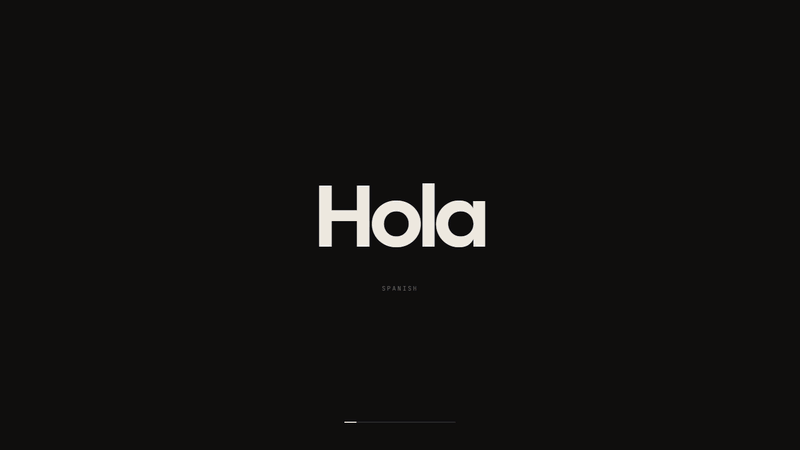
  <br><sub>The greeting: hello in twelve languages, then home in Odia. Then DEEPAK decodes into the hero.</sub>
</p>


## The route

Seven stations, top to bottom. The nav is a departure board that shows the station you're at (NOW) and the one after it (NEXT), and **Route map** lists every stop.

<table>
  <tr>
    <td width="50%" valign="top"><br><b>01 &middot; Hello</b><br>DEEPAK in giant satin blue, the wins in gold, and the train waiting at station 01.</td>
    <td width="50%" valign="top">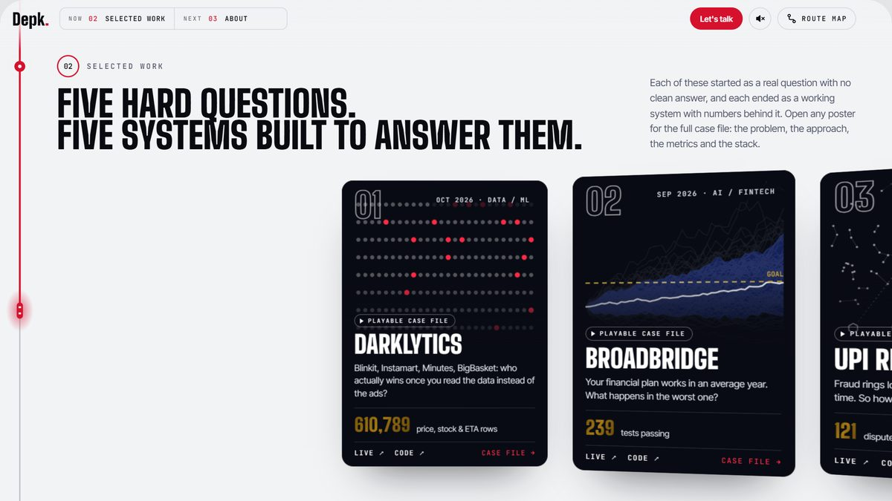<br><b>02 &middot; Selected work</b><br>Five hard questions on a curved poster wall that runs on a spring.</td>
  </tr>
  <tr>
    <td valign="top">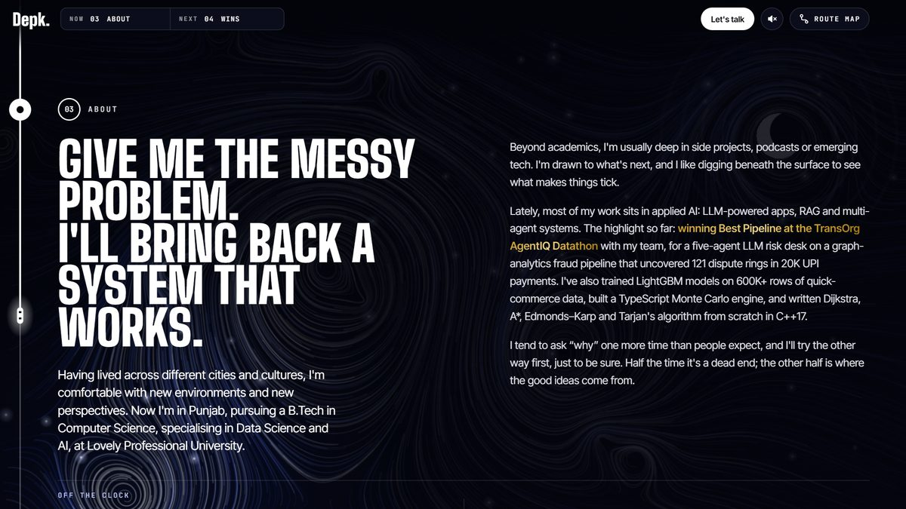<br><b>03 &middot; About</b><br>The story, over a sky of 2,600 particles lit by a torch that follows you.</td>
    <td valign="top">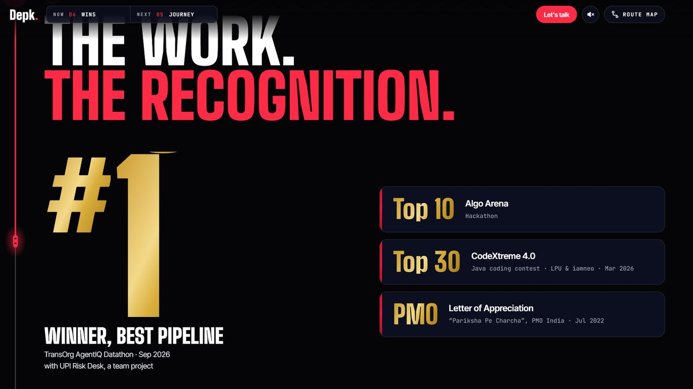<br><b>04 &middot; Wins</b><br>The Datathon win, the contest results and seven certifications in a turning ring.</td>
  </tr>
  <tr>
    <td valign="top">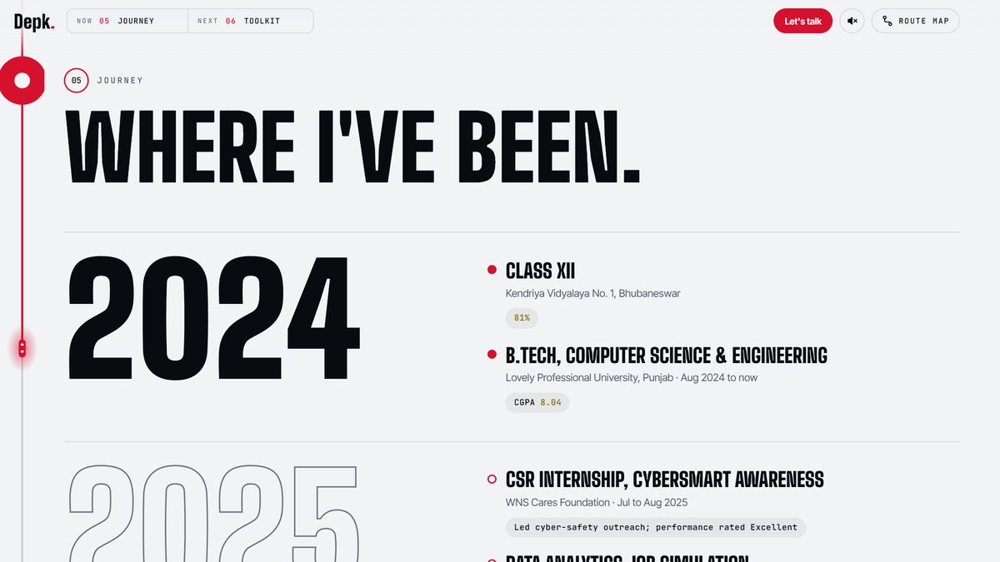<br><b>05 &middot; Journey</b><br>Where I've been, one year at a time. Each year fills in as you reach it.</td>
    <td valign="top">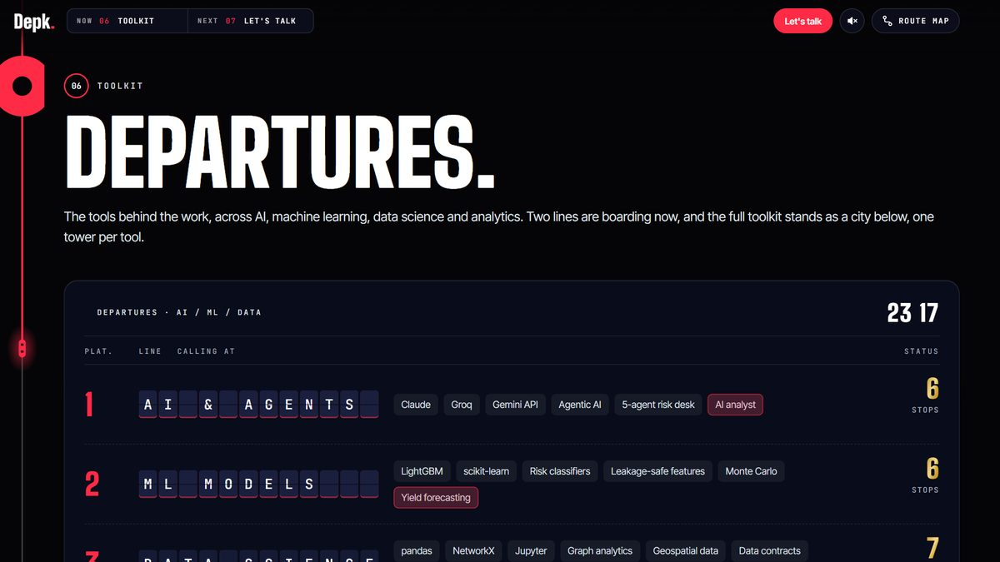<br><b>06 &middot; Toolkit</b><br>A split-flap departures board of tools, then the Skyline: one tower per tool.</td>
  </tr>
  <tr>
    <td valign="top">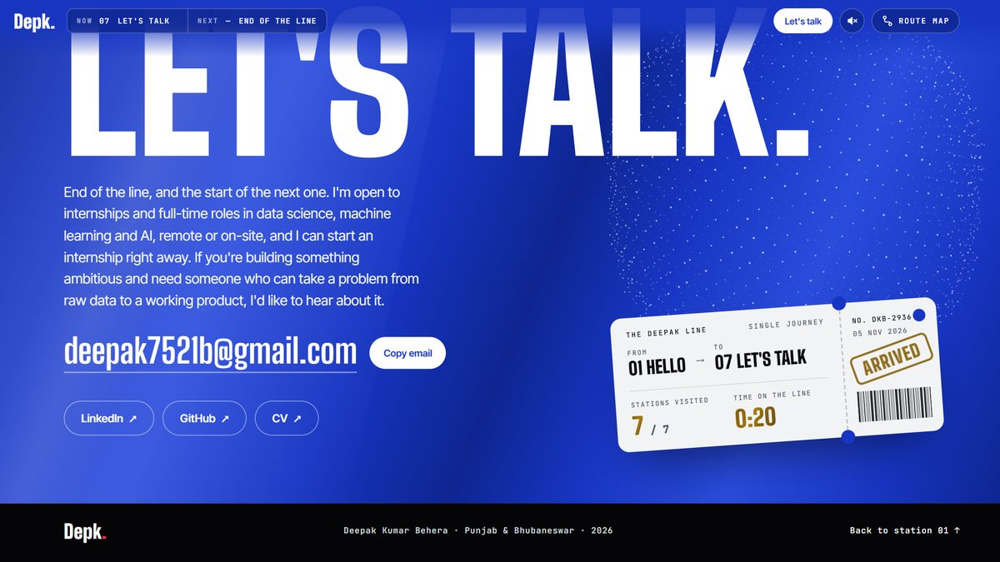<br><b>07 &middot; Let's talk</b><br>The blue terminus, where your ticket gets stamped &ldquo;Arrived&rdquo;.</td>
    <td valign="top">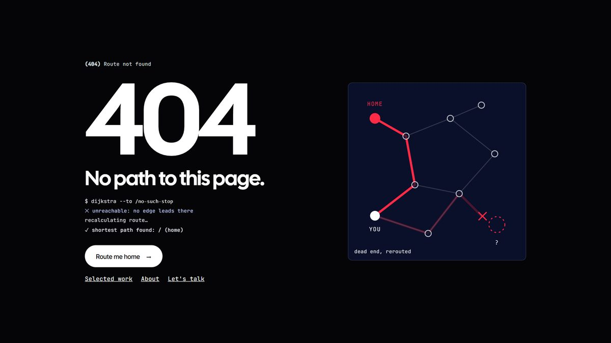<br><b>Off the map &middot; 404</b><br>Lost? The 404 page plays out the failed route, then sends you home.</td>
  </tr>
</table>


## On the line

### Ride the line

Press **Ride the line** and an express ride carries you through every station on its own. Any scroll, tap or key gets you off. Number keys **1&ndash;7** jump straight to a station.

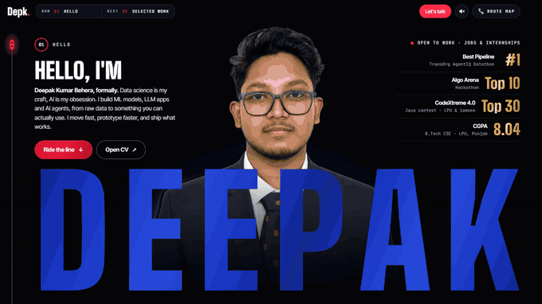

### Case files you can play

Every poster opens a case file with a small working model of the project:

- **LifeLine:** break roads and watch Dijkstra find the detour to the hospital.
- **BroadBridge:** a Monte Carlo toy with sliders, built on made-up assumptions.
- **UPI Risk Desk:** a search through the payment graph uncovers the planted dispute rings.
- **NER SafeRoute:** drop landslides and watch A\* re-plan.
- **Darklytics:** the real aisle data, sortable.


### A sky under the page

The About station sits over 2,600 particles flowing through one vector field. The sky is painted once on a background thread (a Web Worker with OffscreenCanvas), and a torch follows your cursor, or your finger on a phone.

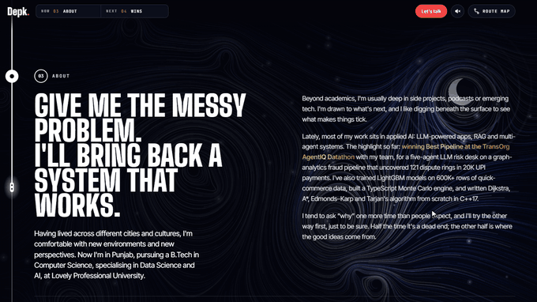

### Seven certifications, in a ring

The certificates turn in a tilted 3D ring as you scroll. Oracle, AWS and Infosys lead; partway through, the ring springs open and IBM and Nasscom join. Every card marked **View** opens its certificate, front or back.

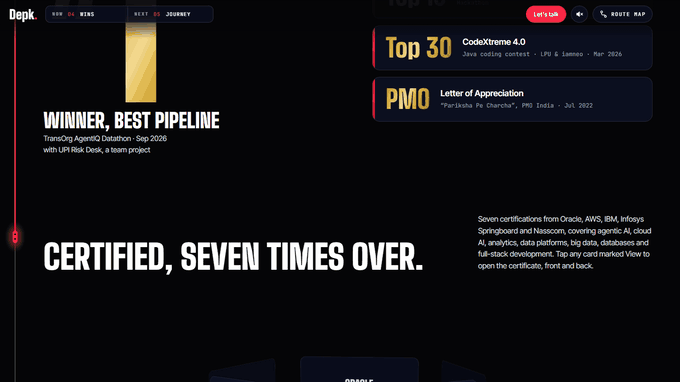

### The Skyline

The toolkit as a night city: one tower per tool, as tall as the number of projects that use it. Pick a project and a sky-train threads its towers.

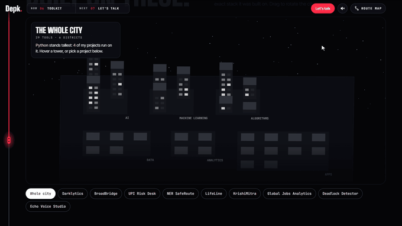

### And a few more

- **Sound**, off until you switch it on: soft chimes synthesised in the browser with Web Audio, a different note at each station. There are no audio files.
- **Your ticket:** at the last stop it's stamped with the stations you visited and your time on the line.
- **New repos appear by themselves:** the "Fresh on GitHub" list reads the public GitHub API, so a newly published repo shows up without editing this site. Give a repo the topic `portfolio-hide` to keep it off.


## On your phone

The same line, the same train and the same motion, sized for a thumb. Swipe the poster wall and the posters lean into the swipe, then bounce into place. The certificate ring turns as you scroll, DEEPAK sends a wave through its letters when you tap it, and buttons squash and spring back under your finger.

<p align="center">
  
  &nbsp;
  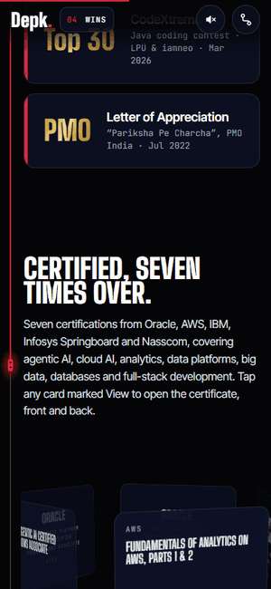
  &nbsp;
  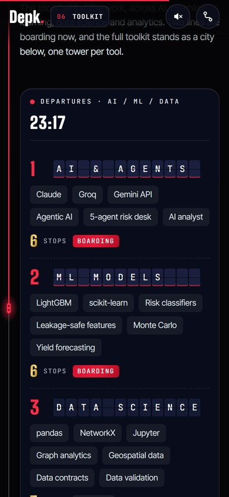
</p>


## How it's built

Plain HTML, CSS and JavaScript, with no build step.

- **Libraries:** GSAP with ScrollTrigger, and Lenis, saved locally in `vendor/`.
- **Fonts:** Inter Tight, JetBrains Mono and Cal Sans are self-hosted in `assets/fonts/`. Big Shoulders Display comes from Google Fonts.
- **Pictures in code:** the posters, the sky, the skyline and the case-file models are all drawn in code, and each one draws once or runs only while it's on screen. The only image files are the portrait, the icons and the share card.
- **Motion:** everything moves by transform or opacity. The page honours `prefers-reduced-motion`.

<details>
<summary><b>Files</b></summary>

```
index.html            the whole line, station by station
css/style.css         layout and look
js/app.js             route line, train, departure board, poster wall, ring, express ride, sound, ticket, fresh repos
js/art.js             poster art and the About sky (painted in a background worker)
js/play.js            the playable case files
js/city.js            the Skyline of tools
404.html              "no path found" page
vendor/               GSAP, ScrollTrigger, Lenis
assets/               portrait (AVIF/WebP sizes), fonts, icons, share card, CV
manifest.webmanifest  install name and icons
.github/readme/       the pictures in this README
```

</details>

**Run it locally:** `python -m http.server` in this folder, then open http://localhost:8000.

The tag `pre-deepak-line` is the site as it was before this line opened. Earlier looks are in the git history.
